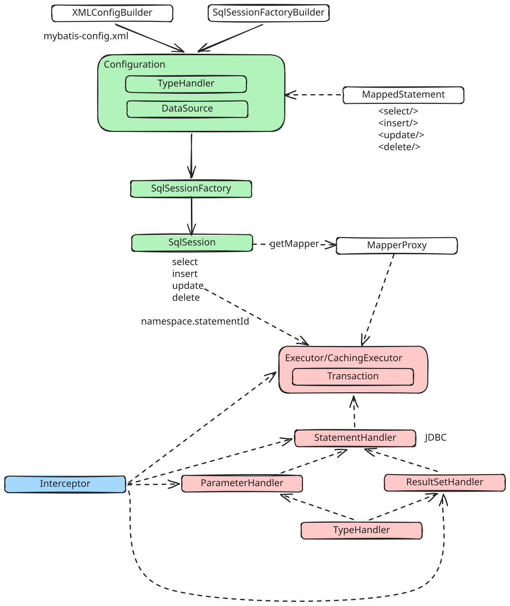

# MyBatis 基础

## 文档

[MyBatis 3 | 简介](https://mybatis.org/mybatis-3/zh_CN/index.html)

## 示例

### 项目结构

```sh
src/
  main/
    java/
      entity/
        User.java
      mapper/
        UserMapper.java
      Main.java
  resources/
    mybatis/
      mapper/
        UserMapper.xml
      config.xml
pom.xml
```

### pom.xml

```xml
<?xml version="1.0" encoding="UTF-8"?>
<project xmlns="http://maven.apache.org/POM/4.0.0"
         xmlns:xsi="http://www.w3.org/2001/XMLSchema-instance"
         xsi:schemaLocation="http://maven.apache.org/POM/4.0.0 http://maven.apache.org/xsd/maven-4.0.0.xsd">
    <modelVersion>4.0.0</modelVersion>

    <groupId>io.github.xianzhan</groupId>
    <artifactId>mybatis-test</artifactId>
    <version>1.0-SNAPSHOT</version>

    <properties>
        <maven.compiler.source>25</maven.compiler.source>
        <maven.compiler.target>25</maven.compiler.target>
        <project.build.sourceEncoding>UTF-8</project.build.sourceEncoding>
    </properties>

    <dependencies>
        <!-- https://mvnrepository.com/artifact/com.mysql/mysql-connector-j -->
        <dependency>
            <groupId>com.mysql</groupId>
            <artifactId>mysql-connector-j</artifactId>
            <version>9.4.0</version>
        </dependency>
        <!-- https://mvnrepository.com/artifact/org.mybatis/mybatis -->
        <dependency>
            <groupId>org.mybatis</groupId>
            <artifactId>mybatis</artifactId>
            <version>3.5.9</version>
        </dependency>
    </dependencies>
</project>
```

### 配置

src/main/resources/mybatis/config.xml

```xml
<?xml version="1.0" encoding="UTF-8" ?>
<!DOCTYPE configuration PUBLIC "-//mybatis.org//DTD Config 3.0//EN" "http://mybatis.org/dtd/mybatis-3-config.dtd">

<configuration>
    <environments default="development">
        <environment id="development">
            <transactionManager type="JDBC"/>
            <dataSource type="POOLED">
                <property name="driver" value="com.mysql.cj.jdbc.Driver"/>
                <property name="url" value="jdbc:mysql://ip:3306/table_name?serverTimezone=UTC&amp;characterEncoding=utf-8&amp;useSSL=false"/>
                <property name="username" value="username"/>
                <property name="password" value="password"/>
            </dataSource>
        </environment>
    </environments>
    <mappers>
        <mapper resource="mybatis/mapper/UserMapper.xml"/>
    </mappers>
</configuration>
```

src/main/resources/mybatis/mapper/UserMapper.xml

```xml
<?xml version="1.0" encoding="UTF-8" ?>
<!DOCTYPE mapper PUBLIC "-//mybatis.org//DTD Mapper 3.0//EN" "http://mybatis.org/dtd/mybatis-3-mapper.dtd">

<mapper namespace="mapper.UserMapper">
    <select id="selectById" resultType="entity.User">
        SELECT id, name FROM t_user WHERE id = #{id}
    </select>
</mapper>
```

### 代码

src/main/java/entity/User.java

```java
package entity;

public class User {

    private Long id;
    private String name;

    public Long getId() {
        return id;
    }

    public void setId(Long id) {
        this.id = id;
    }

    public String getName() {
        return name;
    }

    public void setName(String name) {
        this.name = name;
    }

    @Override
    public String toString() {
        return "User{" +
                "id=" + id +
                ", name='" + name + '\'' +
                '}';
    }
}
```

src/main/java/mapper/UserMapper.java

```java
package mapper;

import entity.User;

public interface UserMapper {

    User selectById(Long id);
}
```

src/main/java/

```java
import entity.User;
import mapper.UserMapper;
import org.apache.ibatis.builder.xml.XMLConfigBuilder;
import org.apache.ibatis.io.Resources;
import org.apache.ibatis.session.Configuration;
import org.apache.ibatis.session.SqlSession;
import org.apache.ibatis.session.SqlSessionFactory;
import org.apache.ibatis.session.SqlSessionFactoryBuilder;

void main() throws IOException {
    SqlSessionFactory sessionFactory;
    // 1. 加载配置
    try (InputStream is = Resources.getResourceAsStream("mybatis/config.xml")) {
        XMLConfigBuilder configBuilder = new XMLConfigBuilder(is);
        Configuration config = configBuilder.parse();
        sessionFactory = new SqlSessionFactoryBuilder().build(config);
    }

    // 2. 获取 session
    try (SqlSession session = sessionFactory.openSession()) {
        // 3. 执行操作
        User user = session.selectOne("mapper.UserMapper.selectById", 10L);
        System.out.println(user);
    }

    // 2. 获取 mapper session
    try (SqlSession session = sessionFactory.openSession()) {
        // 3. 获取 mapper
        UserMapper userMapper = session.getMapper(UserMapper.class);
        // 4. 执行操作
        User user = userMapper.selectById(10L);
        System.out.println(user);
    }
}
```

## 架构



1. `SqlSessionFactoryBuilder`: 用于从 XML 配置文件（或 Java 配置）构建 `SqlSessionFactory`。它读取 `mybatis-config.xml` 中的全局配置，创建 `Configuration` 对象，最终生成 `SqlSessionFactory`。
2. `SqlSessionFactory`: 工厂接口，负责创建 `SqlSession` 实例。通常**一个应用只需一个实例（单例）**，通过它可以获取数据库连接和执行 SQL 的会话。实现类为 `DefaultSqlSessionFactory`。
3. `SqlSession`: 核心运行时接口，代表一次数据库会话。提供了增删改查方法（如 `selectOne`、`selectList`、`insert`、`update`、`delete`），以及获取 Mapper 代理对象的方法（getMapper）。默认实现是 `DefaultSqlSession`。
4. `Configuration`: 保存 MyBatis 全局配置信息的对象，包括数据源、事务管理器、映射器（Mapper）、类型别名、类型处理器等。由 `SqlSessionFactoryBuilder` 构建后存储在 `SqlSessionFactory` 内部。
5. `MapperProxy/MapperProxyFactory`: MyBatis 通过 JDK 动态代理为每个 Mapper 接口生成代理对象。`MapperProxy` 实现了 `InvocationHandler`，将接口方法的调用转发给 `SqlSession` 执行对应的 SQL 语句。`MapperProxyFactory` 负责创建这些代理实例。
6. `MappedStatement`: 封装一条 SQL 语句的详细信息，包括 SQL 文本、参数类型、返回类型、是否缓存、动态 SQL 节点树等。每条 `<select>|<insert>|<update>|<delete>` 标签对应一个 `MappedStatement` 对象，存储在 `Configuration` 中。
7. `TypeHandler`: 桥接 Java 类型和 JDBC 类型之间的转换。例如 `StringTypeHandler`、`IntegerTypeHandler`、`DateTypeHandler` 等，也支持自定义类型处理器。
8. `ParameterHandler`: 负责将用户传入的参数对象转换为 JDBC 预编译语句所需的参数值。它会遍历 `BoundSql` 中的参数映射，调用相应的 `TypeHandler` 设置参数。
9. `ResultSetHandler`: 处理 JDBC 返回的 `ResultSet`，将其映射为 Java 对象（POJO、Map、基本类型等）。内部会调用 `TypeHandler` 进行字段转换，并支持嵌套结果映射和延迟加载。
10. `StatementHandler`: 封装了 JDBC Statement 的操作，包括创建 `Statement`、设置参数、执行查询/更新、处理结果集。`RoutingStatementHandler` 根据 SQL 类型路由到具体的实现（如 `PreparedStatementHandler`、`CallableStatementHandler`）。
11. `Executor`: 真正执行 SQL 的接口，位于 SqlSession 之下。它负责管理一级缓存、二级缓存、事务提交/回滚等。主要实现有：
    - `SimpleExecutor`: 每次执行都新建 Statement。
    - `ReuseExecutor`: 重用预处理语句（`PreparedStatement`）。
    - `BatchExecutor`: 批量执行更新操作。
    - `CachingExecutor`: 装饰器模式，启用二级缓存时包裹其他 `Executor`。
12. `Transaction`: 封装 JDBC 的事务控制（commit、rollback、close）。默认实现为 `JdbcTransaction`（直接使用 `Connection` 的事务）和 `ManagedTransaction`（交给容器管理）。
